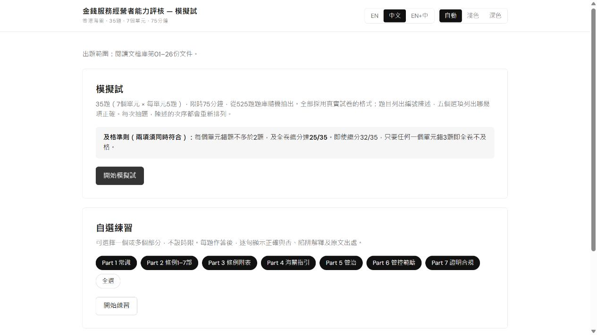

# MSO Competence Assessment — Mock Exam

[繁體中文](README.zh-Hant.md) · [Download the app](https://github.com/leohwlee/mso-ca/releases/latest/download/mso-ca.html) · [Release notes](CHANGELOG.md)

**525 English / Traditional Chinese combination questions**, grounded only in
documents **01–26** of the [reading library](docs/README.md). Practise offline
for the Hong Kong Money Service Operator Competence Assessment, with two modes:
mock exam and custom practice.

## Start in three steps

For notes **and** practice, download **[mso-study-bundle.zip](https://github.com/leohwlee/mso-ca/releases/latest/download/mso-study-bundle.zip)**,
extract the whole archive and open `index.html`. It includes the seven-part notes,
practice app and the cited 01–26 originals. Keep the folders together so study,
practice and source links work offline. The standalone file below provides practice;
its study-note links require the complete bundle.

1. Download **[mso-ca.html](https://github.com/leohwlee/mso-ca/releases/latest/download/mso-ca.html)** from the latest release.
2. Open the downloaded file in a browser. No installation, account or server is needed.
3. Choose **EN**, **中文** or **EN+中**, then start a mock exam or select parts for practice.

The HTML file contains the app, question bank and fonts. You do not need to
download the repository or install Go to use it. The official source documents
are available separately in the reading library.

## Updated study notes in v1.10.1

The seven-part notes now contain 75 topics and 621 bilingual point pairs, with
more complete definitions, lists, conditions and exceptions from the High-priority
originals. All 33 visuals were reviewed: the CDD trigger map now shows cases that
can overlap; two decision trees remain where branches are appropriate. Narrow
screens, table headings and language-switch positioning have also been improved.

Read the [content review](revision/study-notes/depth-review-2026-10-20/REPORT.md),
[visual review and previews](revision/study-notes/visual-refinement-2026-10-20/REPORT.md)
for checked ranges and remaining limits. Counts are not coverage percentages.
The 525 questions, answers, scoring and history format are unchanged.

## Choose how to practise

| Mode | What happens |
|---|---|
| **Mock exam** | 35 random questions, five from each of seven parts, with a 75-minute timer. Submit to see your score, explanations and sources. |
| **Custom practice** | Select one or more Parts 1–7. Work without a timer and see explanations after each answer. |

A mock exam passes only with **at least 25/35 overall and no more than two
wrong in any part**. A score of 32/35 can still fail if all three mistakes are
in one part. The larger sections of the practice bank do not receive more
questions in a mock exam.

Each question has four to six statements and five combination options.
Statements and their option references are reordered together at each draw.
Distractors test conditions, actors, deadlines, thresholds and exceptions;
each statement has its own explanation.

## Your results

Expand **Mock exam results and history** to review completed attempts or save
them to a readable `.md` backup. History is stored in the browser; it does not
sync between devices. **Export it before replacing the app, moving its file,
switching browsers or clearing browser data.** You can load that backup in the
new copy. An unfinished exam containing a retired question must be restarted;
completed recorded scores are preserved.

[Full user guide and troubleshooting](docs/USAGE.md)

## What the bank covers

| Part | Topic | Questions |
|---|---|---:|
| 1 | General AML/CFT and counter-proliferation financing | 60 |
| 2 | AMLO Parts 1–7 | 75 |
| 3 | AMLO Schedules | 65 |
| 4 | C&ED guidelines | 80 |
| 5 | Governance and strategy | 80 |
| 6 | AML/CFT control areas | 100 |
| 7 | Demonstrating and monitoring compliance | 65 |
| **Total** | | **525** |

The bank includes eight official sample questions. The remaining questions are
authored practice material, not released past papers. The v1.9.0 expansion adds
171 reviewed questions, retains 354 and retires three that depended on sources
outside the selected library.

- **01–26:** the only approved sources for active questions. External documents linked by a circular are not automatically included.
- **27–47:** preserved historical reference, excluded from the active bank.
- **Document 24:** English original only; related Chinese questions are labelled **study translations** and retain English deciding quotations.
- **Document 25:** findings are explicitly attributed to the **2022** risk report, not presented as a live risk assessment.

[Source-by-source accounting](docs/QUESTION-SOURCES.md) · [Current review evidence](bank/audit/ACTIVE-SCOPE.md)

## Documentation and maintenance

- **Seven-part study notes:** Included in the study bundle from v1.10.0. [Source and reading pages](revision/study-notes/index.html) contain concepts, definitions, conditions and exceptions from originals 01–26, with actual filename citations. The bank is used only to check omissions. See [scope and maintenance](revision/study-notes/README.md).
- **Study:** [User guide](docs/USAGE.md) and [26-document reading order](docs/README.md).
- **Build and check:** [Development guide](DEVELOPMENT.md).
- **Write or review questions:** [Question format](bank/FORMAT.md), [source maintenance](docs/SOURCE-MAINTENANCE.md) and [agent-neutral authoring workflow](docs/authoring/exam-prep/GUIDE.md).
- **Find other documentation:** [Documentation index](docs/INDEX.md).

Any human or coding agent can begin with [AGENTS.md](AGENTS.md). No particular
agent, plugin or proprietary command is required. Historical reviews remain
verifiable without being presented as reviews of later changes.

The previously released `mso-revision-pack.html` is a **legacy reference
pack with its own older scope**. It is not a third app mode or a complete guide
to the current bank; it is no longer built or included in new releases; see the [archive](revision/README.md).

## Limits and licensing

This is a personal study scope, not the official exam syllabus or a guarantee
of complete coverage. Source checks and independent review reduce errors but
do not guarantee every answer. Refer to original publications and the
[recorded source-conflict decisions](revision/CONFLICT-CALLS.md).
This is not an official C&ED product or legal advice.

Original code and authored material use the [MIT licence](LICENSE). Fonts use
[SIL OFL](web/fonts/OFL.txt). Official publications, sample wording and quotations
retain their publishers' rights; see [content licensing](LICENSE-CONTENT.md).
