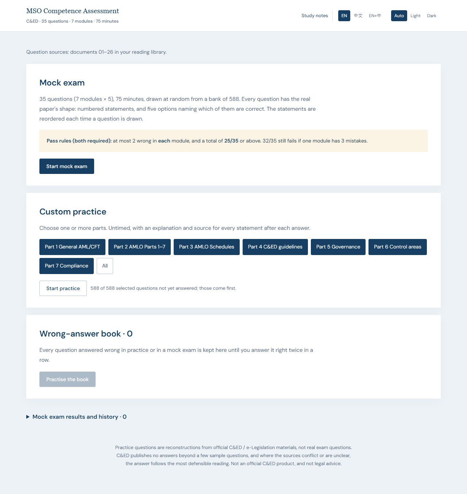
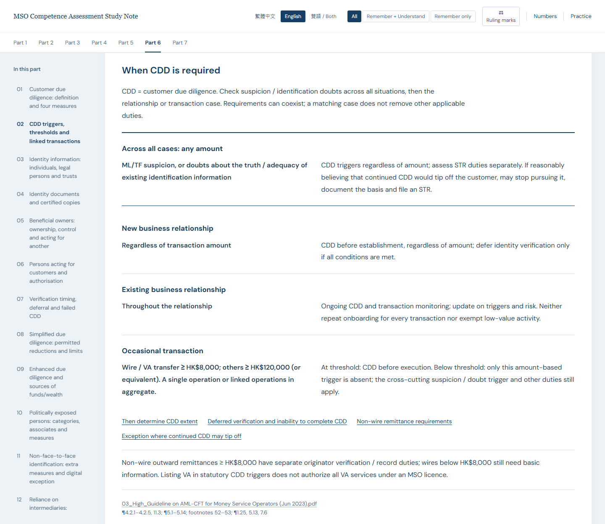

# MSO Competence Assessment — Study and Practice

[繁體中文](README.zh-Hant.md) · [Download the study bundle](https://github.com/leohwlee/mso-ca/releases/latest/download/mso-study-bundle.zip) · [Release notes](CHANGELOG.md) · [The exam-prep skill](skills/exam-prep/README.md)

**Seven-part study notes and 588 combination questions** for the Hong Kong Money
Service Operator Competence Assessment. Read and practise offline in Traditional
Chinese, English or both languages. The selected sources are documents **01–26**
of the [reading library](docs/README.md); practice offers mock exam and custom practice.

## Start here

1. Download **[mso-study-bundle.zip](https://github.com/leohwlee/mso-ca/releases/latest/download/mso-study-bundle.zip)** from the latest release.
2. Extract the whole archive and open `index.html` in a browser. No installation, account or server is needed.
3. Open the seven-part notes or practice. In practice, choose **EN**, **中文** or **EN+中**, then start a mock exam or select parts.

The bundle contains the seven-part notes, the practice app and the cited 01–26
originals. Keep the folders together so study, practice and source links work
offline. You do not need to download the repository or install Go.

*Practice homepage, English. Captured from the v1.13.4 app on 24 October 2026.*

## What's new in v1.13.4

A maintenance release. The mock exam's start and end times now come from one clock reading;
two separate readings could make a paper end 1 ms after the 75 minutes, which showed only as
an occasional failure of the exam-length test. Nothing you read or practise changes: the
notes, the 588 questions, their answers and explanations and the source editions are those of
v1.13.3, and the October code clean-up of v1.13.1 to v1.13.3 changed nothing visible either.

v1.13.0 grew the bank to 588 questions: 36 blind-reviewed questions whose false statements
change one number, period, name or actor in an otherwise faithful sentence — penalty
figures, the six main laws' exact names, the Cap. 629 periods and the HK$120,000 line,
licence periods and fees, the $120,000 / $8,000 CDD lines, the renewal, result and
nomination timelines, the six screening parties, training records and more. The
practice app keeps a **wrong-answer book** (a question stays until it is answered
right twice in a row) and draws unseen questions first in custom practice.

The notes gain a study-tier filter and a **Ruling marks** switch on the toolbar, a
**Numbers** page with 70 amounts, periods, fees and penalties, and 45 new figures,
79 in all: 35 list cards that show how many items a source list has, comparison
tables, and routes for renewal, new licences, CDD and STRs. The purple ruling numbers
(131 marks across 93 rulings) name the owner decisions in
[CONFLICT-CALLS](revision/CONFLICT-CALLS.md) and stay hidden until switched on. The
notes have 75 topics, 626 bilingual point pairs, 14 tables and 65 diagrams. Counts
are not coverage percentages.

Read the [notes' scope and ruling marks](revision/study-notes/README.md)
and the [current review evidence](bank/audit/ACTIVE-SCOPE.md).

*Part 6 reading example, English. Captured from the v1.13.4 notes on 24 October 2026; the CDD cases can overlap, and the purple numbers are the rulings the figure applies.*

## Choose how to practise

| Mode | What happens |
|---|---|
| **Mock exam** | 35 random questions, five from each of seven parts, with a 75-minute timer. Submit to see your score, explanations and sources. |
| **Custom practice** | Select one or more Parts 1–7. Work without a timer and see explanations after each answer. |

A mock exam passes only with **at least 25/35 overall and no more than two
wrong in any part**. A score of 32/35 can still fail if all three mistakes are
in one part. The larger sections of the practice bank do not receive more
questions in a mock exam.

Each question has four to six statements and five combination options.
Statements and their option references are reordered together at each draw.
Distractors test conditions, actors, deadlines, thresholds and exceptions;
each statement has its own explanation.

## Review results

Expand **Mock exam results and history** to review completed attempts.
Results are stored locally in the browser.

[Full user guide and troubleshooting](docs/USAGE.md)

## What the bank covers

| Part | Topic | Questions |
|---|---|---:|
| 1 | General AML/CFT and counter-proliferation financing | 68 |
| 2 | AMLO Parts 1–7 | 81 |
| 3 | AMLO Schedules | 71 |
| 4 | C&ED guidelines | 89 |
| 5 | Governance and strategy | 84 |
| 6 | AML/CFT control areas | 123 |
| 7 | Demonstrating and monitoring compliance | 72 |
| **Total** | | **588** |

The bank includes eight official sample questions. The remaining questions are
authored practice material, not released past papers. See [release notes](CHANGELOG.md)
for earlier changes to the bank.

- **01–26:** the only approved sources for active questions. External documents linked by a circular are not automatically included.
- **27–47:** preserved historical reference, excluded from the active bank.
- **Document 24:** English original only; related Chinese questions are labelled **study translations** and retain English deciding quotations.
- **Document 25:** findings are explicitly attributed to the **2022** risk report, not presented as a live risk assessment.

[Source-by-source accounting](docs/QUESTION-SOURCES.md) · [Current review evidence](bank/audit/ACTIVE-SCOPE.md)

## Make your own: the exam-prep skill

The method behind this bank is packaged as **[exam-prep](skills/exam-prep/README.md)**,
a general-purpose Agent Skill. Give a coding agent any document or copy, and it
returns revision notes, practice questions or an offline mock exam, in any
subject, language and exam format. Examples:
- a policy made into an onboarding quiz;
- a textbook chapter made into notes and true/false items;
- product copy made into certification practice.

The same model was tested side by side with and without the skill, on three
such requests, over five rounds of tightening checks:

| Request | With the skill | Without |
|---|---|---|
| Policy → offline mock exam | 11/11 | 10/11 |
| Chinese handout → notes and true/false | 12/13 | 9/13 |
| Product copy → combination items | 11/12 | 6/12 |

Without the skill, the same model:
- copied the source into keys;
- let one question give away another;
- wrote notes that turned "mainly" into "only";
- wrote notes that spelled out every false statement.

The [skill's page](skills/exam-prep/README.md) has the scenarios it suits, what
makes it different, the full test results and the cost. The download is
[exam-prep-v3.0.0.zip](https://github.com/leohwlee/mso-ca/releases/download/exam-prep-v3.0.0/exam-prep-v3.0.0.zip).

## Documentation and maintenance

- **Seven-part study notes:** Included in the study bundle from v1.10.0. [Source and reading pages](revision/study-notes/index.html) contain concepts, definitions, conditions and exceptions from originals 01–26, with actual filename citations. The bank is used only to check omissions. See [scope and maintenance](revision/study-notes/README.md).
- **Study:** [User guide](docs/USAGE.md) and [26-document reading order](docs/README.md).
- **Build and check:** [Development guide](DEVELOPMENT.md).
- **Write or review questions:** [Question format](bank/FORMAT.md), [source maintenance](docs/SOURCE-MAINTENANCE.md) and [agent-neutral authoring workflow](docs/authoring/exam-prep/GUIDE.md).
- **Make study material from other documents:** the [exam-prep skill](skills/exam-prep/README.md), described [above](#make-your-own-the-exam-prep-skill). This bank's own rules stay in the question format and authoring workflow.
- **Find other documentation:** [Documentation index](docs/INDEX.md).

Any human or coding agent can begin with [AGENTS.md](AGENTS.md). No particular
agent, plugin or proprietary command is required. Historical reviews remain
verifiable without being presented as reviews of later changes.

The previously released `mso-revision-pack.html` is a **legacy reference
pack with its own older scope**. It is not a third app mode or a complete guide
to the current bank; it is no longer built or included in new releases; see the [archive](revision/README.md).

## Limits and licensing

This is a personal study scope, not the official exam syllabus or a guarantee
of complete coverage. Source checks and independent review reduce errors but
do not guarantee every answer. Refer to original publications and the
[recorded source-conflict decisions](revision/CONFLICT-CALLS.md).
This is not an official C&ED product or legal advice.

Original code and authored material use the [MIT licence](LICENSE). Fonts use
[SIL OFL](web/fonts/OFL.txt). Official publications, sample wording and quotations
retain their publishers' rights; see [content licensing](LICENSE-CONTENT.md).
