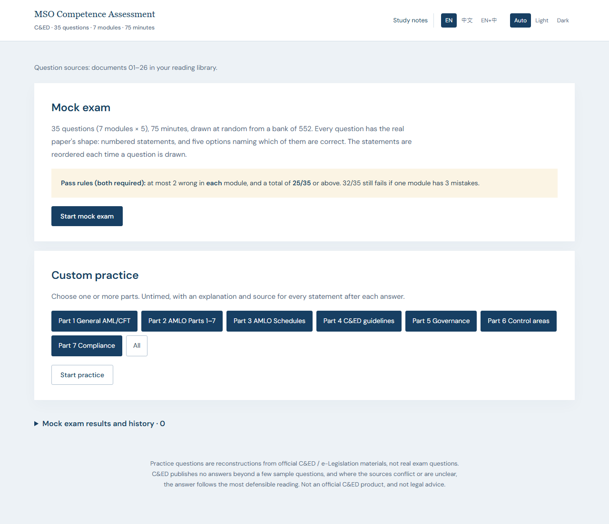
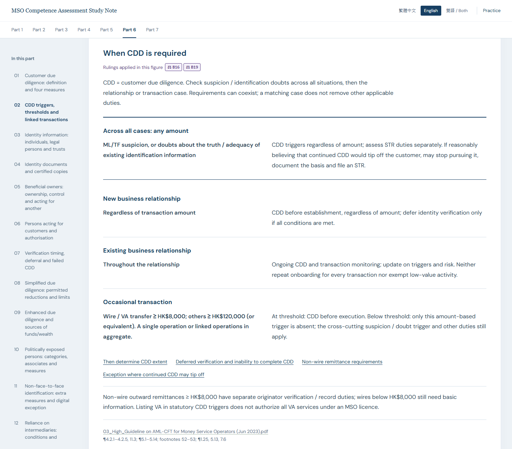

# MSO Competence Assessment — Study and Practice

[繁體中文](README.zh-Hant.md) · [Download the study bundle](https://github.com/leohwlee/mso-ca/releases/latest/download/mso-study-bundle.zip) · [Release notes](CHANGELOG.md)

**Seven-part study notes and 552 combination questions** for the Hong Kong Money
Service Operator Competence Assessment. Read and practise offline in Traditional
Chinese, English or both languages. The selected sources are documents **01–26**
of the [reading library](docs/README.md); practice offers mock exam and custom practice.

## Start here

1. Download **[mso-study-bundle.zip](https://github.com/leohwlee/mso-ca/releases/latest/download/mso-study-bundle.zip)** from the latest release.
2. Extract the whole archive and open `index.html` in a browser. No installation, account or server is needed.
3. Open the seven-part notes or practice. In practice, choose **EN**, **中文** or **EN+中**, then start a mock exam or select parts.

The bundle contains the seven-part notes, the practice app and the cited 01–26
originals. Keep the folders together so study, practice and source links work
offline. You do not need to download the repository or install Go.

*Practice homepage, English. Captured from the v1.12.0 app on 23 October 2026.*

## What's new in v1.12.0

The notes now mark every place where they apply a source-conflict ruling. A purple
number beside a point or figure, such as B27 or E13, names the owner decision in
[CONFLICT-CALLS](revision/CONFLICT-CALLS.md): 131 marks across 93 rulings. A dashed
number means each language keeps its own wording. Each part ends with "Rulings in
this part", which gives the decision, every place it is used and the recorded entry,
with links to the cited originals. Three amber "Check" notes flag points that may
not match their ruling.

The 552 questions and their answers are unchanged. v1.11.0 added 27 reviewed
questions and the exam-focus aids: study tiers, 69 exam traps and new figures. The
notes have 75 topics, 626 bilingual point pairs, 9 tables and 25 diagrams. Counts
are not coverage percentages.

Read the [notes' scope and ruling marks](revision/study-notes/README.md)
and the [current review evidence](bank/audit/ACTIVE-SCOPE.md).

*Part 6 reading example, English. Captured from the v1.12.0 notes on 23 October 2026; the CDD cases can overlap, and the purple numbers are the rulings the figure applies.*

## Choose how to practise

| Mode | What happens |
|---|---|
| **Mock exam** | 35 random questions, five from each of seven parts, with a 75-minute timer. Submit to see your score, explanations and sources. |
| **Custom practice** | Select one or more Parts 1–7. Work without a timer and see explanations after each answer. |

A mock exam passes only with **at least 25/35 overall and no more than two
wrong in any part**. A score of 32/35 can still fail if all three mistakes are
in one part. The larger sections of the practice bank do not receive more
questions in a mock exam.

Each question has four to six statements and five combination options.
Statements and their option references are reordered together at each draw.
Distractors test conditions, actors, deadlines, thresholds and exceptions;
each statement has its own explanation.

## Review results

Expand **Mock exam results and history** to review completed attempts.
Results are stored locally in the browser.

[Full user guide and troubleshooting](docs/USAGE.md)

## What the bank covers

| Part | Topic | Questions |
|---|---|---:|
| 1 | General AML/CFT and counter-proliferation financing | 63 |
| 2 | AMLO Parts 1–7 | 75 |
| 3 | AMLO Schedules | 66 |
| 4 | C&ED guidelines | 83 |
| 5 | Governance and strategy | 81 |
| 6 | AML/CFT control areas | 116 |
| 7 | Demonstrating and monitoring compliance | 68 |
| **Total** | | **552** |

The bank includes eight official sample questions. The remaining questions are
authored practice material, not released past papers. See [release notes](CHANGELOG.md)
for earlier changes to the bank.

- **01–26:** the only approved sources for active questions. External documents linked by a circular are not automatically included.
- **27–47:** preserved historical reference, excluded from the active bank.
- **Document 24:** English original only; related Chinese questions are labelled **study translations** and retain English deciding quotations.
- **Document 25:** findings are explicitly attributed to the **2022** risk report, not presented as a live risk assessment.

[Source-by-source accounting](docs/QUESTION-SOURCES.md) · [Current review evidence](bank/audit/ACTIVE-SCOPE.md)

## Documentation and maintenance

- **Seven-part study notes:** Included in the study bundle from v1.10.0. [Source and reading pages](revision/study-notes/index.html) contain concepts, definitions, conditions and exceptions from originals 01–26, with actual filename citations. The bank is used only to check omissions. See [scope and maintenance](revision/study-notes/README.md).
- **Study:** [User guide](docs/USAGE.md) and [26-document reading order](docs/README.md).
- **Build and check:** [Development guide](DEVELOPMENT.md).
- **Write or review questions:** [Question format](bank/FORMAT.md), [source maintenance](docs/SOURCE-MAINTENANCE.md) and [agent-neutral authoring workflow](docs/authoring/exam-prep/GUIDE.md).
- **Find other documentation:** [Documentation index](docs/INDEX.md).

Any human or coding agent can begin with [AGENTS.md](AGENTS.md). No particular
agent, plugin or proprietary command is required. Historical reviews remain
verifiable without being presented as reviews of later changes.

The previously released `mso-revision-pack.html` is a **legacy reference
pack with its own older scope**. It is not a third app mode or a complete guide
to the current bank; it is no longer built or included in new releases; see the [archive](revision/README.md).

## Limits and licensing

This is a personal study scope, not the official exam syllabus or a guarantee
of complete coverage. Source checks and independent review reduce errors but
do not guarantee every answer. Refer to original publications and the
[recorded source-conflict decisions](revision/CONFLICT-CALLS.md).
This is not an official C&ED product or legal advice.

Original code and authored material use the [MIT licence](LICENSE). Fonts use
[SIL OFL](web/fonts/OFL.txt). Official publications, sample wording and quotations
retain their publishers' rights; see [content licensing](LICENSE-CONTENT.md).
