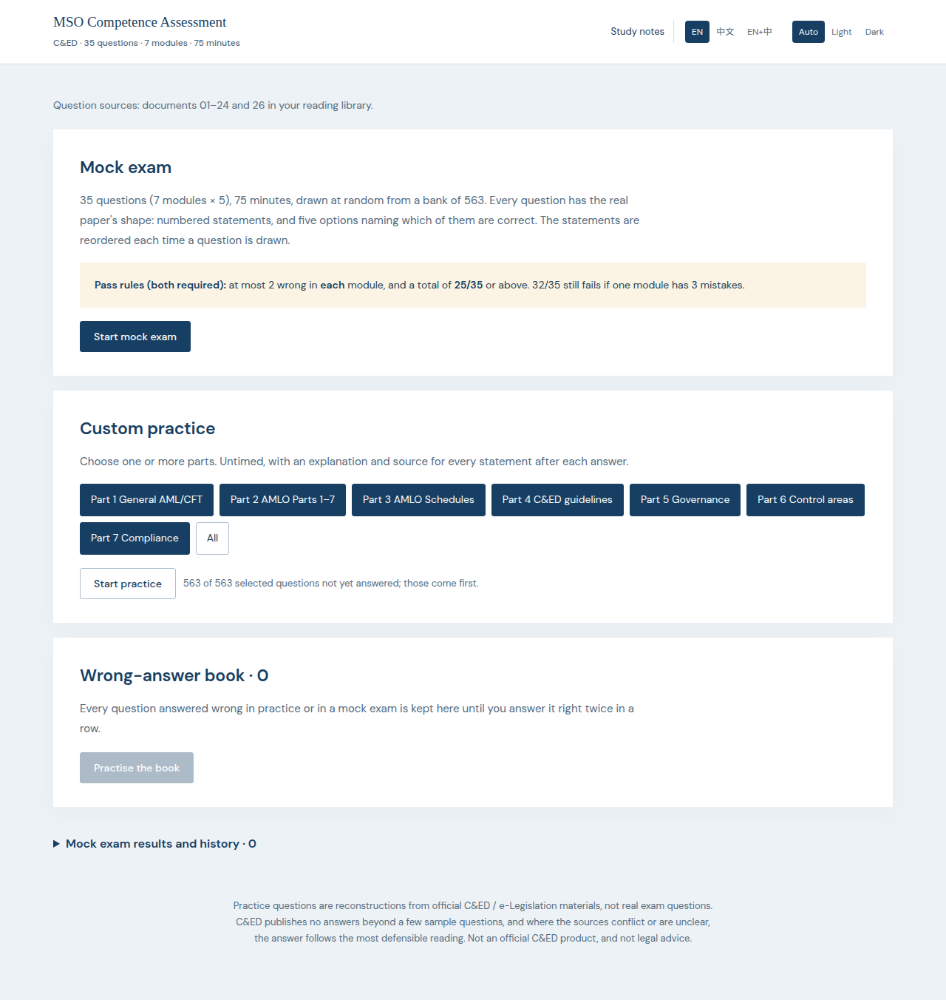
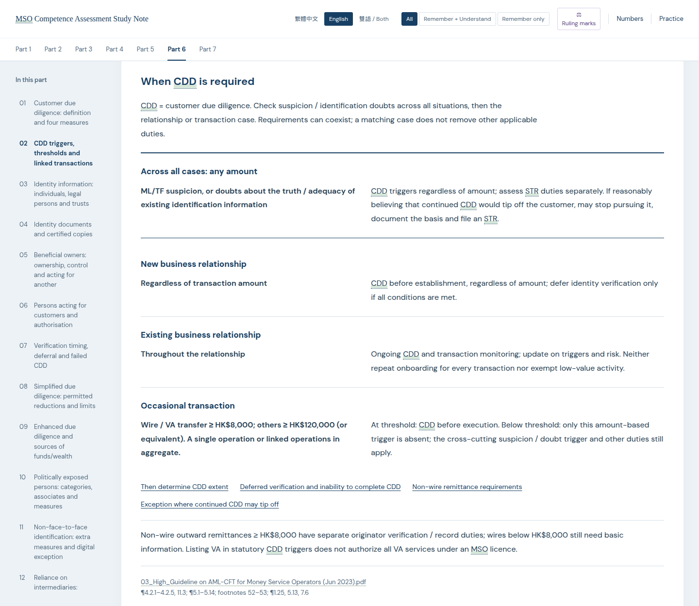

# MSO Competence Assessment — Study and Practice

[繁體中文](README.zh-Hant.md) · [Download the study bundle](https://github.com/leohwlee/mso-ca/releases/latest/download/mso-study-bundle.zip) · [Release notes](CHANGELOG.md) · [The exam-prep skill](skills/exam-prep/README.md)

**Seven-part study notes and 527 combination questions** for the Hong Kong Money
Service Operator Competence Assessment. Read and practise offline in Traditional
Chinese, English or both languages. The selected sources are documents **01–24 and 26**
of the [reading library](docs/README.md); practice offers mock exam and custom practice.

## Start here

1. Download **[mso-study-bundle.zip](https://github.com/leohwlee/mso-ca/releases/latest/download/mso-study-bundle.zip)** from the latest release.
2. Extract the whole archive and open `index.html` in a browser. No installation, account or server is needed.
3. Open the seven-part notes or practice. In practice, choose **EN**, **中文** or **EN+中**, then start a mock exam or select parts.

The bundle contains the seven-part notes, the practice app and the cited 01–24 and 26
originals. Keep the folders together so study, practice and source links work
offline. You do not need to download the repository or install Go.

*Practice homepage, English. Captured from the v1.14.4 app on 16 November 2026.*

## What's new in v1.14.4

A practice-scope change before the 17 November 2026 exam. Nine live questions
that test Cap. 34 (m1-190–m1-197 and m4-419) are retired and those IDs reserved.
m1-151 is revised so it only tests AML/CFT Guideline ¶1.14–1.15 chapter numbers,
with no circular or Money Changers Ordinance material. Documents 16 and 17
remain in daily reading, the study notes and the originals in the study bundle,
but are removed from `question_bank_scope`. The live bank is **563** questions
(52 / 81 / 71 / 88 / 80 / 123 / 68). Part 1’s test floor is now 52. This is a
personal practice-scope decision, not a claim that Cap. 34 will be absent from
the official paper. A further 16 November 2026 practice-scope retirement removed
documents 18, 19, 22, 23, 24 and 26 from the live allowlist as well (still kept
in daily reading and the notes). The live bank is **527** questions
(31 / 81 / 71 / 86 / 77 / 116 / 65). Part 1’s test floor is now 31 and Part 5’s
is 77. This is likewise not a claim that those publications will be absent from
the official paper.

The notes still include the hover/tap legislation tips from v1.14.3: codes and
resolvable section numbers in the body text can be hovered (desktop) or tapped
(phone) to show the official short title, a one-line study gloss, and a note
that this is a study aid, not the official text of the law. Official source,
PDF and appendix citation links — the `<a>`, `.citations`, `.source-citation`
and `.visual-links` links — stay ordinary links and do not get that effect.
Section 25 is resolved from surrounding context: AMLO s.25 is a licensing
exemption; DTROP/OSCO s.25 is the dealing offence. They also still include the
**plain-language rewrite** of all seven parts, with **examples**; **same-section
overlap** trimmed so a rule is not repeated in the same section; and the
**Cap. 221 Schedule 8** six-level fine comparison on Part 2 and the Numbers
page (HK$2,000 / 5,000 / 10,000 / 25,000 / 50,000 / 100,000). Those notes
revisions already shipped in v1.14.2. Cap. 221 is not in the 01–24/26 set texts,
which usually only write “a fine at level n”; the amounts rows cite that
in-scope wording only. The dollar figures themselves come from Cap. 221 Sch. 8,
not from those AMLO / Cap. 34 / Cap. 629 provisions.

Daily reading remains documents **01–24 and 26**. Document 25, the 2022 Hong Kong
Money Laundering and Terrorist Financing Risk Assessment Report, was removed from
personal practice reading and from the live question bank on 14 November 2026, because
it did not appear in the exam the owner sat. This is a study selection, not a finding
that the official exam cannot use the report. Number 25 stays reserved; document 26 is
not renumbered. 23 questions that cited only that report are retired, with their IDs kept.

The practice app still keeps a
**wrong-answer book** (a question stays until it is answered right twice in a
row) and draws unseen questions first in custom practice.

The notes keep the study-tier filter, the **Ruling marks** switch and the
**Numbers** page. Live counts: 74 topics, 574 bilingual point pairs, 75 visuals
(14 tables, 61 diagrams, 33 of them list cards) and 75 amounts, periods, fees
and penalties in eight groups. Counts are not coverage percentages.

v1.14.0 also added the **[exam-prep](skills/exam-prep/README.md)** skill: a
general-purpose Agent Skill that turns any documents or copy into study notes,
practice questions and mock exams.

Read the [notes' scope and ruling marks](revision/study-notes/README.md)
and the [current review evidence](bank/audit/ACTIVE-SCOPE.md).

*Part 6 reading example, English. Captured from the v1.14.4 notes on 16 November 2026; the CDD cases can overlap, and the purple numbers are the rulings the figure applies.*

## Choose how to practise

| Mode | What happens |
|---|---|
| **Mock exam** | 35 random questions, five from each of seven parts, with a 75-minute timer. Submit to see your score, explanations and sources. |
| **Custom practice** | Select one or more Parts 1–7. Work without a timer and see explanations after each answer. |

A mock exam passes only with **at least 25/35 overall and no more than two
wrong in any part**. A score of 32/35 can still fail if all three mistakes are
in one part. The larger sections of the practice bank do not receive more
questions in a mock exam.

Each question has four to six statements and five combination options.
Statements and their option references are reordered together at each draw.
Distractors test conditions, actors, deadlines, thresholds and exceptions;
each statement has its own explanation.

## Review results

Expand **Mock exam results and history** to review completed attempts.
Results are stored locally in the browser.

[Full user guide and troubleshooting](docs/USAGE.md)

## What the bank covers

| Part | Topic | Questions |
|---|---|---:|
| 1 | General AML/CFT and counter-proliferation financing | 31 |
| 2 | AMLO Parts 1–7 | 81 |
| 3 | AMLO Schedules | 71 |
| 4 | C&ED guidelines | 86 |
| 5 | Governance and strategy | 77 |
| 6 | AML/CFT control areas | 116 |
| 7 | Demonstrating and monitoring compliance | 65 |
| **Total** | | **527** |

The bank includes eight official sample questions. The remaining questions are
authored practice material, not released past papers. See [release notes](CHANGELOG.md)
for earlier changes to the bank.

- **01–15, 20 and 21:** the only approved sources for live questions. Documents 16–19, 22–24 and 26 remain in daily reading and the study notes but do not support live questions after 16 November 2026. External documents linked by a circular are not automatically included.
- **25 and 27–47:** preserved historical reference, excluded from the active bank. Number 25 is reserved for the archived 2022 risk assessment report; document 26 is not renumbered.
- **Document 24:** English original only; related Chinese questions are labelled **study translations** and retain English deciding quotations.
- **Document 25:** removed from personal practice reading and from the active question scope on 14 November 2026, because it did not appear in the exam the owner sat. This is a study selection, not a finding that the official exam cannot use the report.

[Source-by-source accounting](docs/QUESTION-SOURCES.md) · [Current review evidence](bank/audit/ACTIVE-SCOPE.md)

## Make your own: the exam-prep skill

The method behind this bank is packaged as **[exam-prep](skills/exam-prep/README.md)**,
a general-purpose Agent Skill. Give a coding agent any document or copy, and it
returns revision notes, practice questions or an offline mock exam, in any
subject, language and exam format. Examples:
- a policy made into an onboarding quiz;
- a textbook chapter made into notes and true/false items;
- product copy made into certification practice.

The same model was tested side by side with and without the skill, on three
such requests, over five rounds of tightening checks:

| Request | With the skill | Without |
|---|---|---|
| Policy → offline mock exam | 11/11 | 10/11 |
| Chinese handout → notes and true/false | 12/13 | 9/13 |
| Product copy → combination items | 11/12 | 6/12 |

Without the skill, the same model:
- copied the source into keys;
- let one question give away another;
- wrote notes that turned "mainly" into "only";
- wrote notes that spelled out every false statement.

The [skill's page](skills/exam-prep/README.md) has the scenarios it suits, what
makes it different, the full test results and the cost. The download is
[exam-prep-v3.0.0.zip](https://github.com/leohwlee/mso-ca/releases/download/exam-prep-v3.0.0/exam-prep-v3.0.0.zip).

## Documentation and maintenance

- **Seven-part study notes:** Included in the study bundle from v1.10.0. [Source and reading pages](revision/study-notes/index.html) contain concepts, definitions, conditions and exceptions from originals 01–24 and 26, with actual filename citations. The bank is used only to check omissions. See [scope and maintenance](revision/study-notes/README.md).
- **Study:** [User guide](docs/USAGE.md) and [25-document reading order](docs/README.md).
- **Build and check:** [Development guide](DEVELOPMENT.md).
- **Write or review questions:** [Question format](bank/FORMAT.md), [source maintenance](docs/SOURCE-MAINTENANCE.md) and [agent-neutral authoring workflow](docs/authoring/exam-prep/GUIDE.md).
- **Make study material from other documents:** the [exam-prep skill](skills/exam-prep/README.md), described [above](#make-your-own-the-exam-prep-skill). This bank's own rules stay in the question format and authoring workflow.
- **Find other documentation:** [Documentation index](docs/INDEX.md).

Any human or coding agent can begin with [AGENTS.md](AGENTS.md). No particular
agent, plugin or proprietary command is required. Historical reviews remain
verifiable without being presented as reviews of later changes.

The previously released `mso-revision-pack.html` is a **legacy reference
pack with its own older scope**. It is not a third app mode or a complete guide
to the current bank; it is no longer built or included in new releases; see the [archive](revision/README.md).

## Limits and licensing

This is a personal study scope, not the official exam syllabus or a guarantee
of complete coverage. Source checks and independent review reduce errors but
do not guarantee every answer. Refer to original publications and the
[recorded source-conflict decisions](revision/CONFLICT-CALLS.md).
This is not an official C&ED product or legal advice.

Original code and authored material use the [MIT licence](LICENSE). Fonts use
[SIL OFL](web/fonts/OFL.txt). Official publications, sample wording and quotations
retain their publishers' rights; see [content licensing](LICENSE-CONTENT.md).
