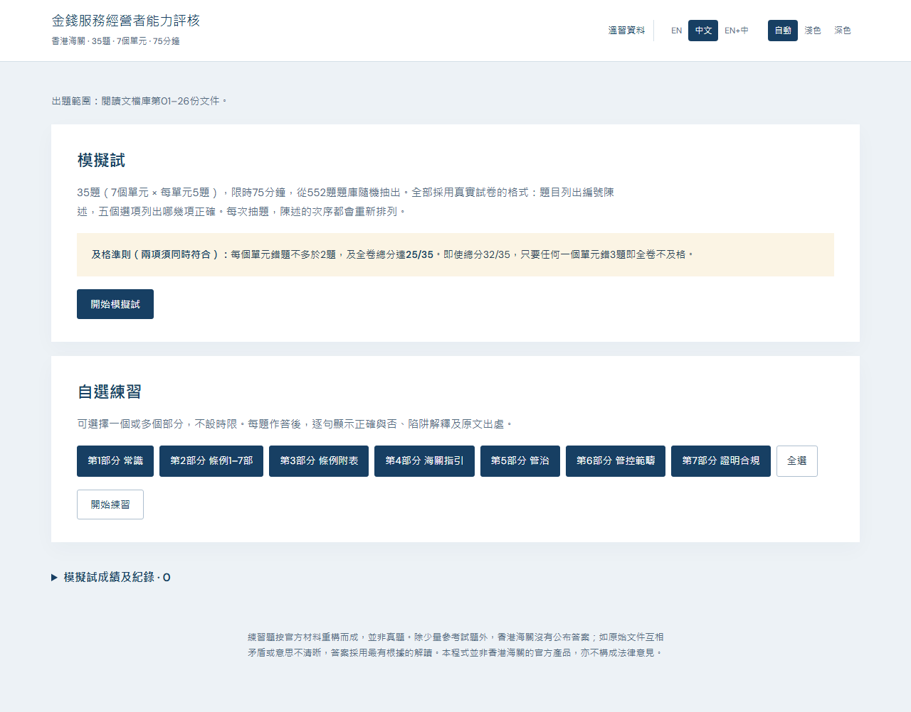
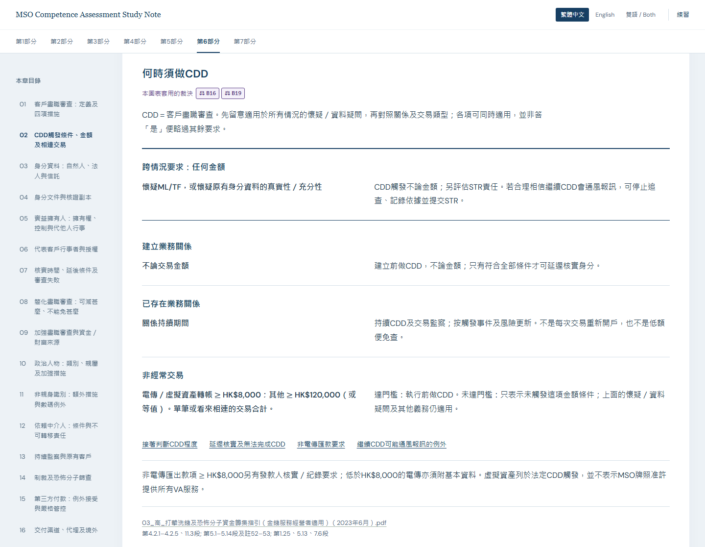

# 金錢服務經營者能力評核 — 溫習與練習

[English](README.md) · [下載完整學習包](https://github.com/leohwlee/mso-ca/releases/latest/download/mso-study-bundle.zip) · [版本更新](CHANGELOG.md)

**七部分溫習筆記及588道組合題**，用於準備香港金錢服務經營者能力評核。
筆記及練習均可離線使用，提供繁體中文、英文及雙語。選定來源為
[閱讀文檔庫](docs/README.zh-Hant.md)的 **01–26**；練習分為**模擬試**與**自選練習**兩個模式。

## 開始使用

1. 從最新發佈版下載 **[mso-study-bundle.zip](https://github.com/leohwlee/mso-ca/releases/latest/download/mso-study-bundle.zip)**。
2. 完整解壓後，用瀏覽器開啟 `index.html`，無須安裝、登入或啟動伺服器。
3. 選擇閱讀七部分筆記或練習。練習時選擇 **EN**、**中文**或 **EN+中**，再開始模擬試或選擇練習部分。

學習包內含七部分筆記、練習App及引用的01–26原件；保留資料夾結構，
閱讀、練習和來源連結才可離線互通。使用時無須下載整個專案或安裝 Go。

*繁體中文練習首頁，2026年10月23日從v1.12.1 App實際截取。*

## v1.12.1 更新

筆記現已標出每個套用來源矛盾裁決的地方。要點或圖表旁的紫色編號（例如B27、E13）對應
[CONFLICT-CALLS](revision/CONFLICT-CALLS.md)中的擁有人裁決：共131處，涉及93項裁決；虛線編號表示兩語各按本身語文。
每部分末設「本部分的裁決」，列出裁決、所有出現位置及裁決記錄原文，並連到所引原件。v1.12.1修正了v1.12.0標出與裁決不一致的三個要點：適當人選測試費（B6）、關長須考慮其他有關事宜（B13）及停止簡化盡職審查的條件（E23）。

未發布的第二批新增36道已盲審題目，錯誤陳述均改動一個數字、期限、名稱或主體，題庫增至588題。v1.11.0新增27道已覆核題目及應試重點：學習層次、69項易錯提示及新圖表。
筆記現有75個主題、626組雙語要點、9張表及25個圖解；數量不是覆蓋率。

詳見[筆記範圍及裁決標記](revision/study-notes/README.md)及[現行覆核證據](bank/audit/ACTIVE-SCOPE.md)。

*第6部分繁體中文閱讀示例，2026年10月23日從v1.12.1筆記實際截取；圖中CDD情況可同時適用，紫色編號是該圖套用的裁決。*

## 選擇練習方式

| 模式 | 使用方式 |
|---|---|
| **模擬試** | 隨機抽出35題，七部分各5題，限時75分鐘。交卷後查看成績、解析及出處。 |
| **自選練習** | 選擇Part 1–7中的一個或多個部分，不設時限，作答後立即查看解析。 |

模擬試須同時達到**總分至少25/35、每部分錯題不多於2題**才算及格。
即使取得32/35，若三道錯題全在同一部分，仍不及格。
練習題庫中題數較多的部分，不會在模擬試獲分配更多題目。

每題包含4至6項陳述及5個組合選項。每次抽題會重排陳述，選項同步對應。
干擾項測試條件、責任人、期限、門檻及例外；每項陳述均有獨立解析。

## 查看成績

展開**模擬試成績及紀錄**，即可重溫已完成試卷。
成績只儲存在瀏覽器本地。

[完整使用指南及常見問題](docs/USAGE.zh-Hant.md)

## 題庫範圍

| 部分 | 內容 | 題數 |
|---|---|---:|
| 1 | 打擊洗錢、恐怖分子資金籌集及擴散資金籌集常識 | 68 |
| 2 | 《打擊洗錢條例》第1至7部 | 81 |
| 3 | 《打擊洗錢條例》的附表 | 71 |
| 4 | 海關頒布的指引 | 89 |
| 5 | 管治及策略 | 84 |
| 6 | 打擊洗錢及恐怖分子資金籌集管控範疇 | 123 |
| 7 | 證明符合規定及監察合規水平 | 72 |
| **合計** | | **588** |

題庫保留8道官方參考試題，其餘為編寫的練習題，並非公開的歷屆真題。
題庫的過往改動見[版本更新](CHANGELOG.md)。

- **01–26：** 現行題目的唯一來源。通函連結的外部文件不會自動納入範圍。
- **27–47：** 保留作歷史參考，不納入有效題庫。
- **第24份：** 只有英文原件；相關中文題標明**學習譯文**，決定答案的引文保留英文。
- **第25份：** 所引結論明確歸屬**2022年**風險評估報告，不冒充即時風險評估。

[逐份來源對照](docs/QUESTION-SOURCES.zh-Hant.md) · [現行覆核證據](bank/audit/ACTIVE-SCOPE.md)

## 文件及維護

- **開始溫習：** [使用指南](docs/USAGE.zh-Hant.md)、[26份資料閱讀順序](docs/README.zh-Hant.md)。
- **建立及檢查程式：** [開發說明](DEVELOPMENT.zh-Hant.md)。
- **出題及覆核：** [題目格式](bank/FORMAT.md)、[來源維護](docs/SOURCE-MAINTENANCE.zh-Hant.md)、[通用編寫流程](docs/authoring/exam-prep/GUIDE.md)。
- **查找其他說明：** [文件索引](docs/INDEX.md)。

任何人工維護者或編程代理均可從[AGENTS.md](AGENTS.md)開始，無須指定代理、外掛或專用指令。
歷史審核繼續保留並可核驗，不會冒充後續改動的覆核證據。

另行提供的 `mso-revision-pack.html` 是**採用舊範圍的歷史溫習參考資料**，
不是第三個App模式，也不是現行題庫的完整溫習指南；後續發佈不再建置或附送；詳見[歸檔說明](revision/README.md)。

## 限制及授權

這是個人指定的溫習範圍，不等於官方考試範圍，也不保證完整涵蓋所有考點。
原文校驗及獨立覆核有助減少錯誤，但不保證每題完全正確。
請參閱官方原件及[文件矛盾的既定處理](revision/CONFLICT-CALLS.md)。
本程式不是海關官方產品，亦非法律意見。

原創程式及編寫內容採[MIT授權](LICENSE)；字型採[SIL OFL](web/fonts/OFL.txt)。
官方出版物、參考試題原文及引文的權利仍屬發布機構，詳見[內容授權](LICENSE-CONTENT.md)。
