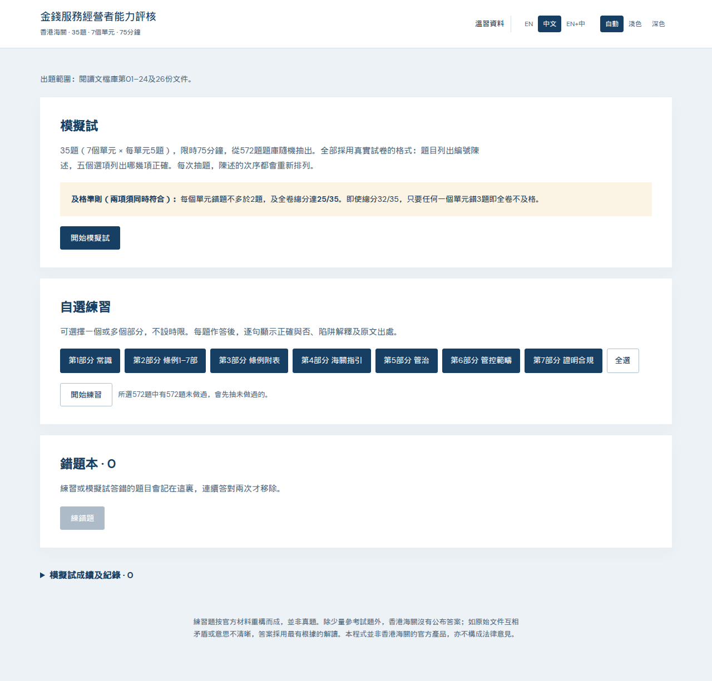
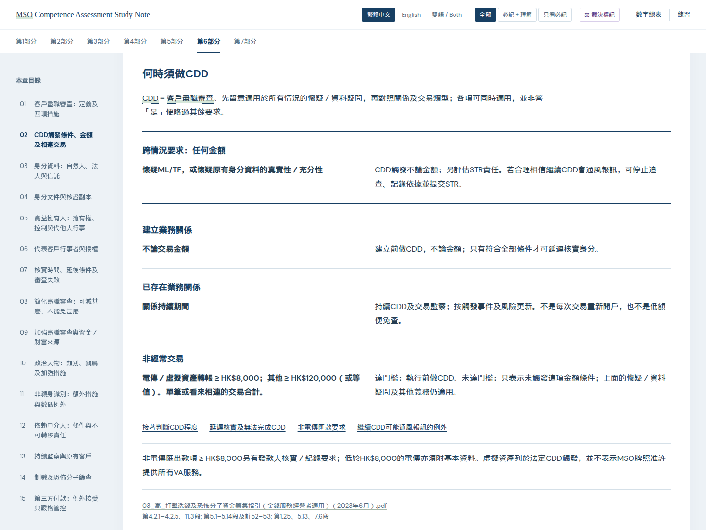

# 金錢服務經營者能力評核 — 溫習與練習

[English](README.md) · [下載完整學習包](https://github.com/leohwlee/mso-ca/releases/latest/download/mso-study-bundle.zip) · [版本更新](CHANGELOG.md) · [exam-prep 技能](skills/exam-prep/README.zh-Hant.md)

**七部分溫習筆記及563道組合題**，用於準備香港金錢服務經營者能力評核。
筆記及練習均可離線使用，提供繁體中文、英文及雙語。選定來源為
[閱讀文檔庫](docs/README.zh-Hant.md)的 **01–24及26**；練習分為**模擬試**與**自選練習**兩個模式。

## 開始使用

1. 從最新發佈版下載 **[mso-study-bundle.zip](https://github.com/leohwlee/mso-ca/releases/latest/download/mso-study-bundle.zip)**。
2. 完整解壓後，用瀏覽器開啟 `index.html`，無須安裝、登入或啟動伺服器。
3. 選擇閱讀七部分筆記或練習。練習時選擇 **EN**、**中文**或 **EN+中**，再開始模擬試或選擇練習部分。

學習包內含七部分筆記、練習App及引用的01–24及26原件；保留資料夾結構，
閱讀、練習和來源連結才可離線互通。使用時無須下載整個專案或安裝 Go。

*繁體中文練習首頁，2026年11月14日從v1.14.3 App實際截取。*

## v1.14.3 更新

溫習筆記版本：正文中的法例代號及可分辨條次，可在電腦懸停或在手機點按，查看官方簡稱、一句白話說明，以及「這是學習提示，不是法例原文」的註明。連到原文PDF或附錄的出處連結（`<a>`、`.citations`、`.source-citation`、`.visual-links`）維持普通連結，不加這種效果。第25條按上下文分辨：AMLO 第25條是發牌豁免；DTROP／OSCO 第25條是處理犯罪得益。

本工作副本的筆記仍包括七部分**白話改寫**並附**例子**、**刪去同一小節內的重複**，以及第2部分及**數字總表**的 **《刑事訴訟程序條例》（第221章）附表8** 六級罰款對照（港幣2,000／5,000／10,000／25,000／50,000／100,000元）。那些筆記修訂已隨 v1.14.2 發出。第221章不在01–24及26指定文本內，那些文本通常只寫「第n級罰款」；表列只引用准許來源中的該等行文。金額本身來自第221章附表8，不是那些《打擊洗錢條例》／第34章／第629章條文寫出的數字。572道題及其答案與解析、評分、題庫範圍（**01–24及26**；第25份仍退役）及練習App均與v1.14.2相同。

選定來源現為**01–24及26**。擁有人於2026年11月14日把第25份（2022年香港洗錢及恐怖分子資金籌集風險評估報告）移出個人練習閱讀及現行題庫，因為他應考時沒有考到這份報告。這是學習取捨，不是斷定正式考試不會用該報告。第25號保留，第26項不重新編號。23道只引用該報告的題目已退役，題號保留。

v1.14.0曾新增七道經獨立盲審的第1部分題目，使該部分當時再次達到60題下限。2026年11月16日，九道第34章題目退役後，現行題庫為**563**題（52／81／71／88／80／123／68）；第1部分測試下限現為52題。這是2026年11月17日應考前的練習範圍決定，不是斷定正式考試不會出現第34章。第16及17項仍在日常閱讀及筆記內。練習App仍保留**錯題本**（答錯的題目保留至連續答對兩次）；自選練習先抽未做過的題目。

筆記仍保留學習層次篩選、「裁決標記」開關及**數字總表**。現行數量：74個主題、574組雙語要點、75個圖表（14張表、61個圖解，其中33張是標明項數的清單卡）及八組共75項金額、期限、費用及刑罰。數量不是覆蓋率。

v1.14.0亦新增 **[exam-prep](skills/exam-prep/README.zh-Hant.md)** 技能：通用的 Agent Skill，可把任何文件或文案變成溫習筆記、練習題及模擬試。

詳見[筆記範圍及裁決標記](revision/study-notes/README.md)及[現行覆核證據](bank/audit/ACTIVE-SCOPE.md)。

*第6部分繁體中文閱讀示例，2026年11月14日從v1.14.3筆記實際截取；圖中CDD情況可同時適用，紫色編號是該圖套用的裁決。*

## 選擇練習方式

| 模式 | 使用方式 |
|---|---|
| **模擬試** | 隨機抽出35題，七部分各5題，限時75分鐘。交卷後查看成績、解析及出處。 |
| **自選練習** | 選擇Part 1–7中的一個或多個部分，不設時限，作答後立即查看解析。 |

模擬試須同時達到**總分至少25/35、每部分錯題不多於2題**才算及格。
即使取得32/35，若三道錯題全在同一部分，仍不及格。
練習題庫中題數較多的部分，不會在模擬試獲分配更多題目。

每題包含4至6項陳述及5個組合選項。每次抽題會重排陳述，選項同步對應。
干擾項測試條件、責任人、期限、門檻及例外；每項陳述均有獨立解析。

## 查看成績

展開**模擬試成績及紀錄**，即可重溫已完成試卷。
成績只儲存在瀏覽器本地。

[完整使用指南及常見問題](docs/USAGE.zh-Hant.md)

## 題庫範圍

| 部分 | 內容 | 題數 |
|---|---|---:|
| 1 | 打擊洗錢、恐怖分子資金籌集及擴散資金籌集常識 | 52 |
| 2 | 《打擊洗錢條例》第1至7部 | 81 |
| 3 | 《打擊洗錢條例》的附表 | 71 |
| 4 | 海關頒布的指引 | 88 |
| 5 | 管治及策略 | 80 |
| 6 | 打擊洗錢及恐怖分子資金籌集管控範疇 | 123 |
| 7 | 證明符合規定及監察合規水平 | 68 |
| **合計** | | **563** |

題庫保留8道官方參考試題，其餘為編寫的練習題，並非公開的歷屆真題。
題庫的過往改動見[版本更新](CHANGELOG.md)。

- **01–15、18–24及26：** 現行有效題目的唯一來源。第16及17項仍在日常閱讀及筆記內，但自2026年11月16日起不再支持有效題目。通函連結的外部文件不會自動納入範圍。
- **25及27–47：** 保留作歷史參考，不納入有效題庫。第25號留給已歸檔的2022年風險評估報告，第26項不重新編號。
- **第24份：** 只有英文原件；相關中文題標明**學習譯文**，決定答案的引文保留英文。
- **第25份：** 擁有人於2026年11月14日把它移出個人練習閱讀及現行題庫，因為他應考時沒有考到這份報告。這是學習取捨，不是斷定正式考試不會用該報告。

[逐份來源對照](docs/QUESTION-SOURCES.zh-Hant.md) · [現行覆核證據](bank/audit/ACTIVE-SCOPE.md)

## 自己製作：exam-prep 技能

本題庫背後的方法已整理成通用的 Agent Skill **[exam-prep](skills/exam-prep/README.zh-Hant.md)**。
把任何文件或文案交給編程代理，它就會做出溫習筆記、練習題或離線模擬試，不限科目、
語言及考試形式。例如：
- 把政策做成入職測驗；
- 把課本章節做成筆記及判斷題；
- 把產品文案做成認證練習題。

同一個模型在使用及不使用技能的情況下，就三個這類要求做了對照測試，檢查項目
經五輪逐步收緊：

| 要求 | 使用技能 | 不使用 |
|---|---|---|
| 政策 → 離線模擬試 | 11/11 | 10/11 |
| 中文講義 → 筆記及判斷題 | 12/13 | 9/13 |
| 產品文案 → 組合題 | 11/12 | 6/12 |

不使用技能時，同一個模型：
- 把原文照抄成答案；
- 讓一題洩露另一題；
- 筆記把「主要」寫成「只」；
- 筆記寫出每一條錯誤陳述。

[技能頁面](skills/exam-prep/README.zh-Hant.md)載有適用情境、與別不同之處、完整測試結果及成本。
下載：[exam-prep-v3.0.0.zip](https://github.com/leohwlee/mso-ca/releases/download/exam-prep-v3.0.0/exam-prep-v3.0.0.zip)。

## 文件及維護

- **開始溫習：** [使用指南](docs/USAGE.zh-Hant.md)、[25份資料閱讀順序](docs/README.zh-Hant.md)。
- **建立及檢查程式：** [開發說明](DEVELOPMENT.zh-Hant.md)。
- **出題及覆核：** [題目格式](bank/FORMAT.md)、[來源維護](docs/SOURCE-MAINTENANCE.zh-Hant.md)、[通用編寫流程](docs/authoring/exam-prep/GUIDE.md)。
- **用其他文件製作溫習資料：** 見上文的 [exam-prep 技能](#自己製作exam-prep-技能)。本題庫自身的規則仍以題目格式及編寫流程為準。
- **查找其他說明：** [文件索引](docs/INDEX.md)。

任何人工維護者或編程代理均可從[AGENTS.md](AGENTS.md)開始，無須指定代理、外掛或專用指令。
歷史審核繼續保留並可核驗，不會冒充後續改動的覆核證據。

另行提供的 `mso-revision-pack.html` 是**採用舊範圍的歷史溫習參考資料**，
不是第三個App模式，也不是現行題庫的完整溫習指南；後續發佈不再建置或附送；詳見[歸檔說明](revision/README.md)。

## 限制及授權

這是個人指定的溫習範圍，不等於官方考試範圍，也不保證完整涵蓋所有考點。
原文校驗及獨立覆核有助減少錯誤，但不保證每題完全正確。
請參閱官方原件及[文件矛盾的既定處理](revision/CONFLICT-CALLS.md)。
本程式不是海關官方產品，亦非法律意見。

原創程式及編寫內容採[MIT授權](LICENSE)；字型採[SIL OFL](web/fonts/OFL.txt)。
官方出版物、參考試題原文及引文的權利仍屬發布機構，詳見[內容授權](LICENSE-CONTENT.md)。
